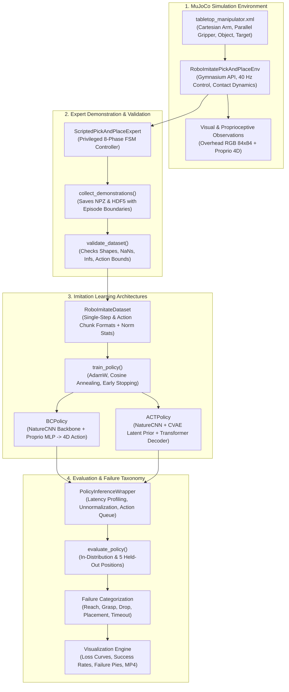
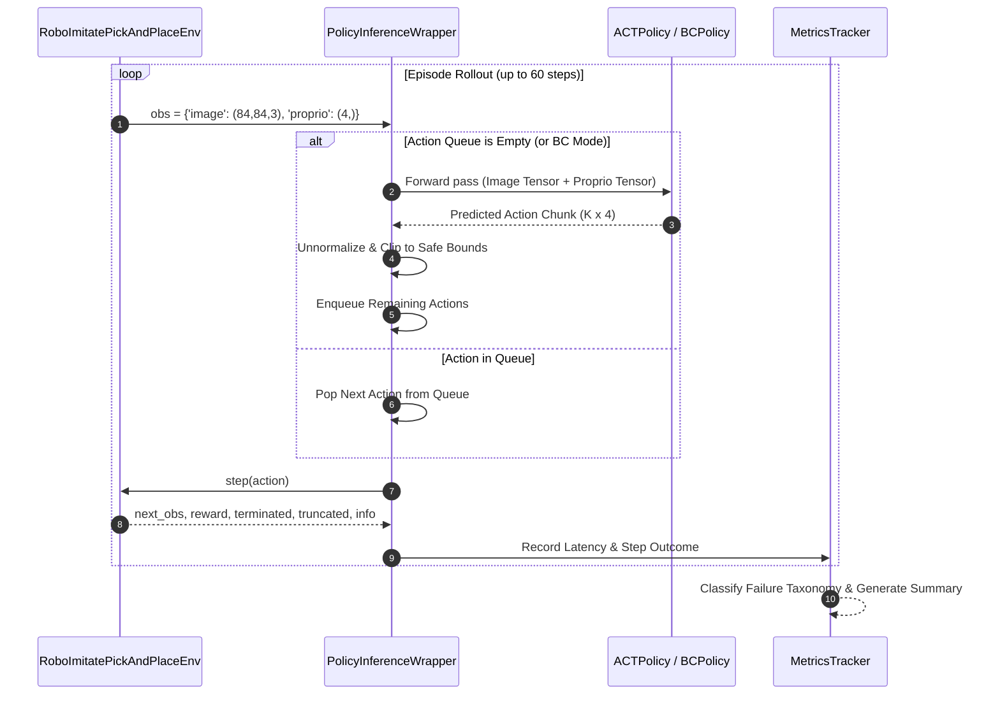

# RoboImitate 🤖

> **Vision-Based Robotic Manipulation Through Imitation Learning**  
> Complete, production-grade robotics learning framework featuring MuJoCo simulation, expert demonstration collection, Behavior Cloning (BC), Action Chunking with Transformers (ACT), and standardized generalization benchmarks.

[](https://www.python.org/downloads/)
[](LICENSE)
[](https://github.com/google-deepmind/mujoco)
[](https://pytorch.org/)
[](https://gymnasium.farama.org/)

---

## 📖 1. Overview & Problem Statement

Imitation learning for contact-rich robotic manipulation suffers from two major challenges:
1. **Covariate Shift & Compounding Errors**: In standard single-step supervised behavior cloning (BC), small trajectory prediction errors compound over time, driving the robot into unfamiliar states where the policy fails catastrophically.
2. **Multimodality & Temporal Consistency**: Demonstrations often contain multiple valid ways to solve a task. Traditional regressive heads average across modes, yielding erratic or blurry actions.

**RoboImitate** tackles these problems in a simulated tabletop pick-and-place manipulation setup by providing:
- A high-fidelity **MuJoCo** simulation environment adhering to the Farama **Gymnasium** API.
- An 8-phase finite-state-machine **Scripted Expert Demonstrator** capable of autonomous dataset generation with 100% task completion.
- A **Behavior Cloning (BC)** convolutional baseline alongside an **Action Chunking with Transformers (ACT)** architecture incorporating Conditional Variational Autoencoder (CVAE) style latent priors.
- An evaluation suite with **5 held-out generalization test positions**, automated failure mode categorization, latency profiling, and demonstration video logging.

---

## 🏛️ 2. System Architecture

### End-to-End System Flow



### Policy Inference & Action Chunking Pipeline



---

## 🗂️ 3. Repository Structure

```
RoboImitate/
├── README.md                           # Master documentation with Mermaid architecture
├── LICENSE                             # MIT Open Source License
├── pyproject.toml                      # Build metadata & pytest configurations
├── requirements.txt                    # Project dependencies
├── .gitignore                          # Excludes datasets, checkpoints, videos, virtualenvs
├── configs/                            # Centralized YAML configuration files
│   ├── environment.yaml                # Simulation timestep, frame skip, table & target bounds
│   ├── training.yaml                   # Hyperparameters for BC & ACT policies
│   └── evaluation.yaml                 # Benchmark rollout settings & failure categories
├── src/
│   └── roboimitate/                    # Core library package
│       ├── __init__.py                 # Version & package metadata
│       ├── env/                        # Gymnasium environment & simulation assets
│       │   ├── __init__.py
│       │   ├── manipulation_env.py     # RoboImitatePickAndPlaceEnv implementation
│       │   ├── wrappers.py             # Normalization & MP4 video recorder
│       │   └── assets/
│       │       └── tabletop_manipulator.xml  # MuJoCo scene XML
│       ├── data/                       # Demonstration collection & dataset handling
│       │   ├── __init__.py
│       │   ├── collect.py              # Automated trajectory collection
│       │   ├── dataset.py              # PyTorch Dataset (BC & ACT chunking)
│       │   └── validate.py             # Dataset verification & corruption detector
│       ├── policies/                   # Neural network policy architectures
│       │   ├── __init__.py
│       │   ├── behavior_cloning.py     # CNN + MLP baseline policy
│       │   ├── act_policy.py           # Transformer + CVAE Action Chunking policy
│       │   └── inference.py            # Latency tracker, unnormalizer & action queue
│       ├── training/                   # Model training pipelines
│       │   ├── __init__.py
│       │   └── train.py                # Supervised training loop & early stopping
│       ├── evaluation/                 # Benchmarks, baselines & metrics
│       │   ├── __init__.py
│       │   ├── baseline.py             # Scripted 8-phase expert FSM controller
│       │   ├── evaluate.py             # In-distribution & held-out evaluator
│       │   └── metrics.py              # Metrics accumulator & failure taxonomy
│       ├── visualization/              # Visualization & plotting
│       │   ├── __init__.py
│       │   └── plots.py                # Loss curves, comparison bars, failure pies
│       └── utils/                      # Utilities
│           ├── __init__.py
│           ├── checkpoint.py           # PyTorch state saving & loading
│           ├── config.py               # YAML configuration loader & merger
│           └── reproducibility.py      # Multi-library deterministic seed manager
├── scripts/                            # Command-line entry points
│   ├── setup_check.py                  # 6-step environment verification tool
│   ├── collect_demos.py                # Demonstration dataset collector
│   ├── validate_dataset.py             # Dataset validation CLI
│   ├── train_policy.py                 # Policy training script (BC & ACT)
│   ├── evaluate_policy.py              # Policy & baseline evaluation script
│   └── run_pipeline.py                 # Full end-to-end automated runner
├── tests/                              # Automated pytest suite (18 unit tests)
│   ├── test_environment.py            # Environment initialization, stepping & reset
│   ├── test_dataset.py                # Dataset chunking, normalization & validation
│   ├── test_policy.py                 # Forward passes, backward gradients & CVAE
│   ├── test_metrics.py                # Latency & failure categorization tests
│   ├── test_checkpoint.py             # Checkpoint save/load & device mapping
│   ├── test_physics_stability.py      # MuJoCo actuator & contact stability
│   └── debug_expert.py                # Expert rollout inspection tool
├── docs/                               # Detailed technical documentation
│   ├── architecture.md                 # System architecture details
│   ├── methodology.md                  # Mathematical formulations & expert FSM
│   ├── troubleshooting.md              # Rendering, CUDA & configuration tips
│   └── experiment_report_template.md   # Standardized experiment report template
├── outputs/                            # Generated checkpoints and loss curves
└── results/                            # Evaluation reports, CSVs, and plots
```

---

## 🚀 4. Quick Start & Installation

### Step 1: Environment Setup

```bash
# Clone the repository
git clone https://github.com/USER/RoboImitate.git
cd RoboImitate

# Create virtual environment
python -m venv .venv

# Activate virtual environment
# On Linux / macOS:
source .venv/bin/activate
# On Windows (PowerShell):
.\.venv\Scripts\Activate.ps1

# Install core dependencies
pip install -r requirements.txt

# Install RoboImitate in editable mode
pip install -e .
```

### Step 2: Diagnostic Verification

Verify that Python runtime, PyTorch, MuJoCo physics, Gymnasium stepping, off-screen rendering, and scientific libraries are fully functional:

```bash
python scripts/setup_check.py
```

---

## ⚡ 5. Execution Commands

### 1. Collect Demonstrations
Collect expert trajectories with deterministic seeding into compressed NPZ and HDF5 formats:
```bash
python scripts/collect_demos.py --episodes 20 --save-dir data/demos
```

### 2. Validate Dataset
Run deep integrity inspection for missing fields, NaNs, Infs, and action bounds:
```bash
python scripts/validate_dataset.py --dataset-path data/demos/expert_demonstrations.npz
```

### 3. Train Policies
Train Behavior Cloning (BC) baseline:
```bash
python scripts/train_policy.py --model bc --epochs 30 --batch-size 32
```

Train Action Chunking with Transformers (ACT):
```bash
python scripts/train_policy.py --model act --epochs 30 --batch-size 16
```

*(For quick CPU smoke tests, pass `--smoke-test` to train for 2 epochs)*.

### 4. Evaluate Trained Policies or Scripted Baseline
Evaluate the scripted expert baseline across in-distribution and held-out positions:
```bash
python scripts/evaluate_policy.py --model baseline --episodes 20
```

Evaluate a trained BC policy checkpoint:
```bash
python scripts/evaluate_policy.py --model bc --checkpoint outputs/checkpoints/bc/checkpoint_best.pt --episodes 20
```

Evaluate a trained ACT policy checkpoint:
```bash
python scripts/evaluate_policy.py --model act --checkpoint outputs/checkpoints/act/checkpoint_best.pt --episodes 20
```

### 5. Run the Complete End-to-End Pipeline
Execute the full automated workflow (verification $\to$ collection $\to$ validation $\to$ training $\to$ evaluation $\to$ comparison):
```bash
python scripts/run_pipeline.py --episodes 15 --epochs 5 --eval-episodes 5
```

---

## 🧪 6. Automated Testing

RoboImitate includes an automated test suite with **18 passing unit tests**:

```bash
pytest
```

Test coverage includes:
- `test_environment.py`: Gymnasium interfaces, observation shapes, action clipping, reset seeding.
- `test_dataset.py`: Synthetic dataset loading, ACT action chunking, normalization statistics, corruption checks.
- `test_policy.py`: BC and ACT forward passes, backward gradients, CVAE latent style prior, action unnormalization.
- `test_metrics.py`: Metric accumulation, latency statistics, failure mode taxonomy classification.
- `test_checkpoint.py`: Checkpoint saving, restoring, and CPU/CUDA device re-mapping.
- `test_physics_stability.py`: MuJoCo actuator equilibrium and numerical contact stability.

---

## 📊 7. Benchmark Evaluation & Generalization

### Generalization Protocol
To test policy robustness against spatial covariate shift, rollouts are benchmarked against **5 distinct held-out positions** outside the training distribution:

| Benchmark Position | Workspace Coordinates $(x, y, z)$ | Location Characteristics |
| :--- | :---: | :--- |
| `held_out_far_left` | `[-0.22, 0.50, 0.42]` | Left lateral boundary |
| `held_out_center_near`| `[0.00, 0.40, 0.42]` | Front-center workspace edge |
| `held_out_far_back` | `[-0.10, 0.65, 0.42]` | Deep rear workspace boundary |
| `held_out_near_left` | `[-0.20, 0.38, 0.42]` | Front-left workspace corner |
| `held_out_center_back`| `[0.00, 0.65, 0.42]` | Center-rear table zone |

### Failure Taxonomy
Failures are deterministically categorized using physical state telemetry:
- **`reach_failure`**: End-effector never came within 0.05m of the object.
- **`grasp_failure`**: Reached object but failed to establish friction grasp / lift off table.
- **`drop_failure`**: Successfully lifted object but dropped it before reaching target zone.
- **`placement_failure`**: Reached target zone perimeter but released outside target radius.
- **`timeout`**: Exceeded 60 episode steps without completing task.
- **`out_of_bounds`**: End-effector or object drifted outside physical safety workspace.

---

## 📈 8. Generated Artifacts & Reports

Execution writes structured artifacts to standard output directories:
- **`outputs/checkpoints/`**: PyTorch `.pt` files containing model weights, optimizer states, normalization statistics, and experiment configurations.
- **`outputs/plots/`**: Training and validation loss curves (`bc_loss_curve.png`, `act_loss_curve.png`).
- **`results/`**: Machine-readable JSON summaries, per-episode CSV telemetry logs, generalization bar charts, failure mode distribution pie charts, and `comparison_summary.png`.
- **`results/videos/`**: Optional MP4 episode rollout recordings labeled with success/failure status.

---

## 📜 9. License

This project is licensed under the MIT License - see the [LICENSE](LICENSE) file for details.
