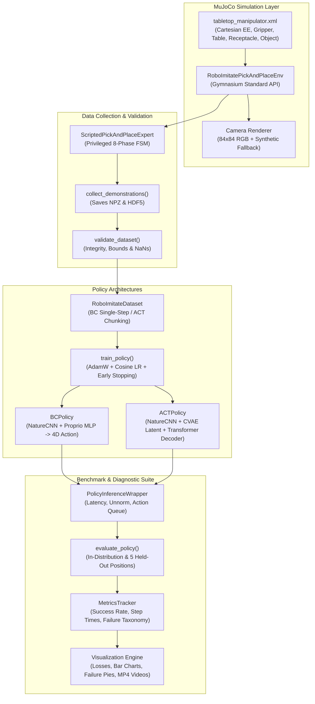

# RoboImitate System Architecture

This document describes the software architecture, data pipelines, policy models, and evaluation flow for **RoboImitate**, a vision-based robotic manipulation imitation learning framework.

---

## 1. High-Level Component Flow

---

## 2. Policy Architectures

### Behavior Cloning (BC)

The BC policy maps visual observations and proprioception directly to single-step continuous end-effector actions:
- **Vision Encoder**: `NatureCNN` processing `(B, 3, 84, 84)` images with 3 convolutional stages (channels 32, 64, 64) and linear projection to 256 dimensions.
- **Proprioception Encoder**: Linear layer mapping 4D state `[ee_x, ee_y, ee_z, gripper]` to 64 dimensions.
- **Action Head**: Multi-layer perceptron (320 $\to$ 256 $\to$ 128 $\to$ 4) predicting delta end-effector velocities $[\Delta x, \Delta y, \Delta z]$ and binary/continuous gripper commands.

### Action Chunking with Transformers (ACT)

The ACT policy models multimodal demonstration distributions and mitigates compounding errors by predicting chunks of future actions:
- **Conditioning**: Encodes current image $I_t$ and proprioception $q_t$ as memory tokens in a transformer decoder.
- **CVAE Latent Style Variable**: Encodes action chunk sequence $[a_t, \dots, a_{t+K-1}]$ into latent distribution $z \sim \mathcal{N}(\mu, \sigma)$ during training. At inference, $z$ defaults to the prior mean $\mathbf{0}$.
- **Transformer Decoder**: Cross-attends sequence queries (length $K$) against memory tokens $[z, \text{vision\_token}, \text{proprio\_token}]$.
- **Action Horizon Queue**: An inference queue executes predicted chunks over $K$ timesteps, minimizing per-step inference latency.

---

## 3. Generalization Benchmark

Policies are tested across 5 distinct held-out spatial positions outside the uniform training cube:
1. `held_out_far_left` ($[-0.22, 0.50, 0.42]$)
2. `held_out_center_near` ($[0.00, 0.40, 0.42]$)
3. `held_out_far_back` ($[-0.10, 0.65, 0.42]$)
4. `held_out_near_left` ($[-0.20, 0.38, 0.42]$)
5. `held_out_center_back` ($[0.00, 0.65, 0.42]$)

